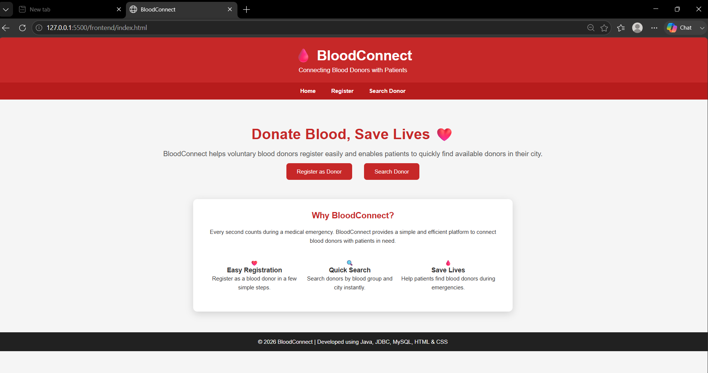
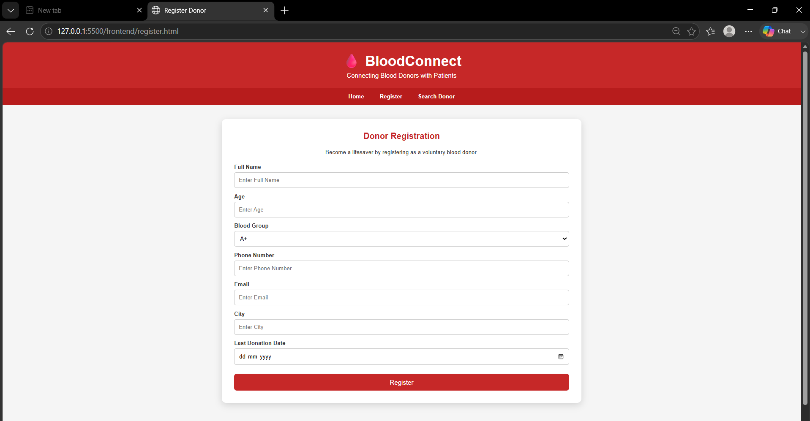
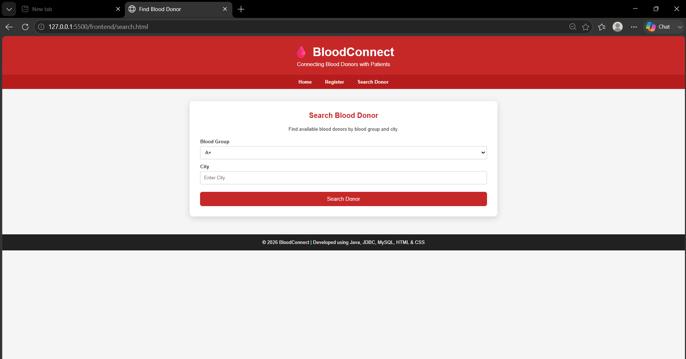
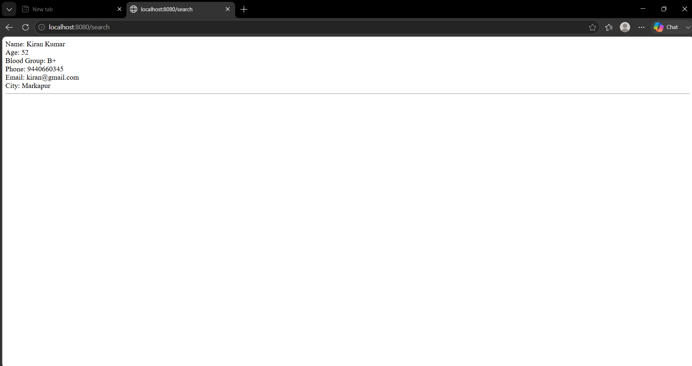

# 🩸 BloodConnect

A Blood Donor Management System developed using **Java, JDBC, MySQL, HTML, CSS, Docker, and GitHub**.

## 📌 Overview

BloodConnect is a web-based application that allows users to register as blood donors and enables patients to search for available donors based on blood group and city.

The project demonstrates backend development using Java and JDBC, database integration with MySQL, and a simple responsive frontend using HTML and CSS.

---

## 🚀 Features

- Blood Donor Registration
- Search Donors by Blood Group
- Search Donors by City
- MySQL Database Integration
- Dockerized Backend & Database
- Simple Responsive User Interface

---

## 🛠️ Technologies Used

- Java
- JDBC
- MySQL
- HTML5
- CSS3
- Docker
- Git
- GitHub

---

## 📂 Project Structure

```
BloodConnect
│
├── backend/
├── frontend/
├── database/
├── docker-compose.yml
└── README.md
```

---

## ▶️ How to Run

1. Clone this repository.

```bash
git clone https://github.com/RaagaVarshini10/BloodConnect.git
```

2. Start Docker Desktop.

3. Run:

```bash
docker compose up --build
```

4. Open the frontend in your browser.

5. Register a donor or search for available donors.

---

## 📸 Project Screenshots

### Home Page



### Register Page



### Search Page



### Search Results



---

## 👩‍💻 Author

**Raaga Varshini**
